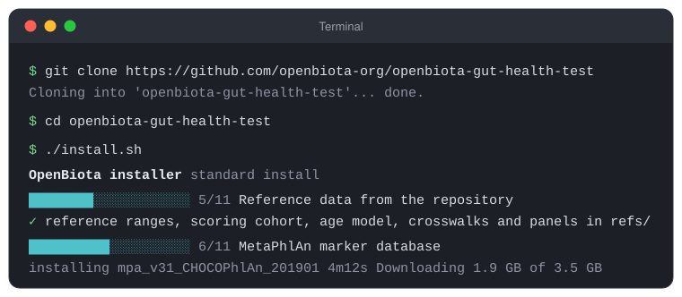

<p class="eyebrow">Get started</p>

# Quickstart

From nothing to your first Gut Health Test report in three steps: **install**
(one command), **add your sample** (copy two files), **run** (one command).
This page assumes you have never used a terminal. If you have, the whole
thing is:

```bash
git clone https://github.com/openbiota-org/openbiota-gut-health-test
cd openbiota-gut-health-test
./install.sh                          # two to three hours (~190 GB of references); safe to re-run
# copy SAMPLE_1.fastq.gz and SAMPLE_2.fastq.gz into fastq/SAMPLE/
bin/openbiota run                     # asks full or lite → results/SAMPLE/SAMPLE_report.pdf, then opens it
```

To see what you are working towards, two finished reports from real samples
are in
[`sample-reports/`](https://github.com/openbiota-org/openbiota-gut-health-test/tree/main/sample-reports):
one community the index places as broadly disturbed, one in the healthy range.

## Before you start: open a terminal

Everything below is typed into a **terminal** — a window where you type a
command, press <kbd>Return</kbd>, and the computer runs it and prints what happened.
It looks like this:



=== "macOS"

    Press <kbd>&#8984; Cmd</kbd> + <kbd>Space</kbd>, type `Terminal`, press <kbd>Return</kbd>. (It is also in
    *Applications → Utilities → Terminal*.)

=== "Ubuntu / Linux"

    Press <kbd>Ctrl</kbd> + <kbd>Alt</kbd> + <kbd>T</kbd>, or search your applications for *Terminal*.

Three things to know, and then you know enough:

- **Commands are typed exactly as shown**, then <kbd>Return</kbd>. The `$` at the
  start of a line in a picture is the terminal's prompt — do not type it.
  Copying a line from this page and pasting it in is fine, and the little
  copy button at the right of each grey box does that for you.
- **`git clone <address>` downloads a copy of a project.** It creates a
  folder named after the project, inside whatever folder the terminal is
  currently in (your home folder, when it opens). **`cd <folder>`** moves the
  terminal into that folder, which is where every later command is typed.
  That folder is a normal folder: you can open it in the Finder or the file
  manager, and you will, to drop your files in.
- **A command that is still working has not frozen.** The installer shows a
  progress bar and what it is doing; a long download can take a while. If
  you close the window or lose power, run the same command again and it
  continues from where it stopped.

## What you need

| | |
|---|---|
| A computer | A Mac (Intel or Apple silicon) or a Linux machine with **64 GB of memory**. One of the catalogue lanes (MetaPhlAn 4) holds a 37 GB index in memory; on a machine that cannot spare that, the lane is stopped by the operating system and every report is missing it. The installer says so at its first step if the machine is short, and proves each lane at its last. |
| Free disk | About **230 GB** for the standard install (190 GB of it reference catalogues), **on the computer's own disk** — your home folder is the right place. Not a network share and not an external drive formatted for Windows (exFAT/NTFS): `git clone` itself fails there with *unable to write file … Permission denied*, and the installer refuses to start. (The optional full install is about 1.3 TB more; see the end of this page.) |
| Internet | The installer downloads the reference databases once, roughly 135 GB; every download resumes if it is interrupted. |
| Two to three hours | On a fast connection the time goes to the publishers' own servers, two index builds and a ten-minute trial run of every lane, not to your line. You can leave it and come back; it continues where it stopped. |
| Your sample | **Two FASTQ files** from a shotgun-sequenced stool sample, usually named something like `SAMPLE_1.fastq.gz` and `SAMPLE_2.fastq.gz`. |

The FASTQ files are the **raw reads**, not a PDF and not a 16S amplicon run.
If you tested with [Tiny Health](https://www.tinyhealth.com), their support
team will send download links for your raw FASTQ files on request. Any
Illumina paired-end stool metagenome of roughly five million read pairs or
more works; the report states its own depth and flags what depth limits.

## Step 1 — Install

Open a terminal and type (or paste) these three lines, pressing <kbd>Return</kbd>
after each:

```bash
git clone https://github.com/openbiota-org/openbiota-gut-health-test
cd openbiota-gut-health-test
./install.sh
```

What each line does:

1. **`git clone …`** downloads the project into a new folder called
   `openbiota-gut-health-test`, inside the folder the terminal is in — your
   home folder when it opens, which is where it should be. On a Mac that has
   never run a developer tool, macOS may first offer to install its *command
   line developer tools* — accept, wait for it to finish, then run the line
   again. If the clone ends with `unable to write file … Permission denied`,
   the terminal was in a network share or an external drive; type `cd ~`
   and run the line again.
2. **`cd openbiota-gut-health-test`** moves into that folder.
3. **`./install.sh`** does everything else, in fourteen numbered steps with a
   progress bar:

   | | |
   |---|---|
   | Checks the machine | operating system, disk space, memory, internet |
   | Installs the tools | `diamond`, `bowtie2`, `samtools`, `fastp`, a recent Python. On a Mac it uses [Homebrew](https://brew.sh) and offers to install it if you do not have it; on Linux it uses `apt` or `dnf` and asks before using `sudo`. **It will ask for your computer password once**, for that. |
   | Builds the environments | the program itself and MetaPhlAn 3, each in its own folder inside the project; nothing else on your computer is changed |
   | Unpacks the reference data | 250 MB that came with the download: the ranges every reading is scored against, the reference cohort, the age model, and the protein references the search database is built from |
   | Downloads and builds the databases | the MetaPhlAn marker database (a 0.4 GB download, indexed to 3.5 GB), the protein search database (built locally), the metabolic model library |
   | Builds the human-read filter | downloads the human genome and indexes it; an hour or so on a laptop. `./install.sh --skip-host-index` leaves it out; the report then cannot state the human DNA fraction, which for stool is usually under 1 %. |
   | Installs the catalogue lanes | the five 2025 organism catalogues — MetaPhlAn 4, mOTUs 4, Kraken 2 / UHGG, SingleM, sylph / GlobDB — that name most of what lives in a gut: their tools, then about 130 GB of references (190 GB on disk). The downloads take as long as the publishers' servers allow — minutes on a fast line, longer on a slow one — and resume if interrupted. |
   | Checks everything | that every piece is in place |
   | Tries every detection lane | each one is run once on a small made-up sample (about ten minutes), and has to find what that sample was made from — so a tool that is installed but cannot run is found now, not an hour into your first report. Then the installer prints the two steps left. |

   Every step is skipped if it was already done, so if anything interrupts
   the install — a dropped connection, a closed laptop — just run
   `./install.sh` again and it continues. `./install.sh --list` shows what
   is done and what is not. The full detail of every step is in
   `install.log`, in the project folder.

!!! tip "It ended with a red ✗"
    Read the line after the ✗ — it says what went wrong and what to do — then
    run `./install.sh` again. The last lines of `install.log` are printed
    with it. [Installation](INSTALL.md#when-something-goes-wrong) lists the
    situations the installer knows how to explain.

## Step 2 — Add your sample

Inside the project folder there is a folder called **`fastq`**. Make a folder
in it for your sample, and copy your two FASTQ files into that folder:

```
openbiota-gut-health-test/
└── fastq/
    └── my-sample/
        ├── my-sample_1.fastq.gz
        └── my-sample_2.fastq.gz
```

That is, the two files end up at `fastq/my-sample/my-sample_1.fastq.gz` and
`fastq/my-sample/my-sample_2.fastq.gz`. You can do this in the Finder or the
file manager — drag the two files into the new folder — or in the terminal:

```bash
mkdir fastq/my-sample
cp ~/Downloads/my-sample_1.fastq.gz ~/Downloads/my-sample_2.fastq.gz fastq/my-sample/
```

A few rules, all of them simple:

- **Keep the file names you were given.** The sample is named by its files:
  `NAME_1.fastq.gz` and `NAME_2.fastq.gz` — or `NAME_R1` and `NAME_R2` —
  are the sample `NAME`. The folder's name is up to you.
- **Do not unzip, trim, filter or shorten the files.** The pipeline does its
  own quality assessment and host filtering and needs every read to
  normalise correctly. `.fastq.gz` and plain `.fastq` are both fine.
- **One folder per sample.** Several samples can sit side by side, each in
  its own folder; the run command below then asks which one you mean, and
  `bin/openbiota run-all` does them all and adds a comparison.
- Nothing you put in `fastq/` is ever added to git; the whole folder is
  ignored. There is a `README.md` in it that says the same thing.

## Step 3 — Run

In the terminal, still in the project folder:

```bash
bin/openbiota run
```

That is the actual program. (The installer also puts `openbiota` on your
path, so in any *new* terminal window the same command is just
`openbiota run`; and `openbiota` on its own prints what it can do and what
is on this machine, like any command.) You can also name the sample
directly instead of relying on the `fastq/` folder:

```bash
bin/openbiota run fastq/my-sample                               # the sample's folder
bin/openbiota run ~/Downloads/S_1.fastq.gz ~/Downloads/S_2.fastq.gz   # the two files
```

Before anything slow starts, the files are checked: not a FASTQ (a FASTA, a
PDF, a web page saved by mistake), empty, a download that stopped early, or
two files that are not the two halves of one sample — each is refused with
a sentence saying what is wrong.

With several samples in `fastq/`, it lists them and asks which (a number,
several numbers, or `a` for all); `--sample my-sample` answers in advance.

It then asks **which report** — and this is the one choice worth knowing
about:

| | full | lite |
|---|---|---|
| What it has | every section: the 485-target pathogen screen, the mycobiome, strain typing and strain placement, and everything in lite | your community and microbial groups, every organism the five 2025 catalogues can name, the organisms that need attention, 45 metabolite pathways, resemblance to published disease patterns, microbiome age, biofilm, the gut-skin axis, and what the research says you can do about each finding |
| Needs | the full install (`openbiota install --full`: ~1.1 TB more, most of a day) | the standard install |
| First run of a sample, desktop | two and a half to three hours | one to two hours (the catalogue lanes and the metabolic-model simulation) |
| The same sample again | about ten minutes | about five minutes |

`--mode full` or `--mode lite` answers in advance; without a terminal (a
script, a cron job) the choice is automatic — full when the full install is
present, lite otherwise — and is printed. Asking for `--mode full` on a
machine without the full install does not start an hour-long run that
cannot finish: it says what is missing and offers to install it. The
report's title carries a small *full* or *lite* so you always know which
one you are reading; a lite report simply has no pathogen, mycobiome or
strain sections, and its remaining sections are numbered 1 to 23.

While it runs, the terminal shows the stage in progress on one line, with
a clock, and keeps one line for each stage that has finished. It ends with
the outcome, and **the last line is where the report is**:

```
my-sample: lite report from 2 FASTQ files (9.6GB). Usually one to two hours for a new sample, about five minutes for one run before.
  ✓ input validation                                               1m12s
  ✓ translated search (diamond blastx)                             6m40s
  …
  ✓ competitive confirmation                                      18m09s
  ✓ report extension                                              16m03s
  ✓ PDF report                                                     2m10s

✓ Done in 50m57s: lite report, all 19 stages ran, 332 organisms named.
  Everything else is in results/my-sample/: summary.txt (the full text summary), results.json, run.log.
  Opening the report in your PDF viewer.

Report: /home/you/openbiota-gut-health-test/results/my-sample/my-sample_report.pdf
```

The report opens on its own (`--no-open` stops that). If a stage could not
run, the ending says which one and why in a line — for example that a
program is missing and `./install.sh` will add it — and the report is
still written, with that part marked as not assessed. Every step and every
number is kept in the files beside the PDF; `--verbose` shows each step on
the screen as it happens, and `--summary` prints the full text summary
(several thousand lines) when the run ends.

Start at page 1. [Reading the report](OUTPUT.md) explains the seven-band
scale every reading is placed on and what each section means. Next to the
PDF, `results.json` holds every number in it, machine-readable, and
`run.log` the full log of the run.

## Optional: the full install

The standard install produces the **lite** report: the complete picture of
your community — every organism the five 2025 catalogues can name — pathways,
disease patterns, microbiome age, the organisms that need attention and what
the research says about them. The **full** report adds the 485-target
pathogen screen, the mycobiome, strain typing and placement, and the GlobDB
genome archive that confirms its native clusters — about **1.1 TB** more
reference data and most of a day to fetch and build. When you have the disk:

```bash
bin/openbiota install --full          # the same as ./install.sh --full
```

It is resumable like everything else. Until it is done, `openbiota run`
makes lite reports; afterwards it makes full ones (and asks, at a terminal,
which you want). [Installation](INSTALL.md) describes every step, and
[Organism detection](EXPANDED_DETECTION.md) the lanes.

## Useful next commands

```bash
bin/openbiota                        # what it can do, and the state of this machine
bin/openbiota run --help             # every flag: threads, panels, subject data
bin/openbiota run --subject-age 42   # the age model also reports its error
bin/openbiota run --compact          # one-screen answer in the terminal
bin/openbiota run-all                # every sample in fastq/, plus a comparison
bin/openbiota install --full         # add the full install's detection lanes
bin/openbiota doctor                 # is everything installed? what inputs are there?
bin/openbiota selftest               # run every detection lane on made-up reads (about ten minutes)
bin/openbiota depth-check            # was the sequencing deep enough?
bin/openbiota panels                 # the metabolite pathways and their genes
bin/openbiota profiles               # the disease-pattern profiles
make test                            # the unit tests; no network or FASTQ needed
```

The full command reference is in [Usage](USAGE.md).
